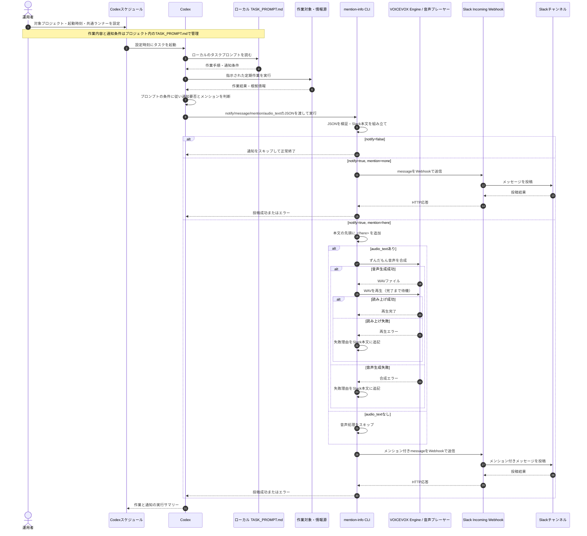

# 汎用定期処理のシーケンス

スケジュール、タスク固有プロンプト、共通Slack CLIの責務を分けています。

## 役割

- **Codexスケジュール（cron）**: プロジェクトを指定時刻に起動します。GitHub Actionsは使いません。
- **TASK_PROMPT.md**: タスクごとの作業手順、通知条件、メンション基準を定義します。Gitで管理し、実行時は選択したローカルプロジェクトのファイルを読みます。
- **Codex**: プロンプトに沿って作業し、結果から通知要否を判断して共通JSONを作ります。
- **mention-info CLI**: 共通JSONを検証し、`audio_text`がある場合はVOICEVOXで音声を合成・再生してからSlack Webhookへ中継します。音声処理に失敗しても失敗理由を添えて通知を続けます。タスクの内容や通知しきい値は判断しません。
- **Slack Webhook / Slack**: CLIから受け取ったメッセージをチャンネルに投稿します。

通知JSONは`{"notify": false}`または`{"notify": true, "message": "...", "mention": "none|here", "audio_text": "..."}`です。Webhook URLは`SLACK_WEBHOOK_URL`環境変数から読み込み、値を表示・記録しません。
