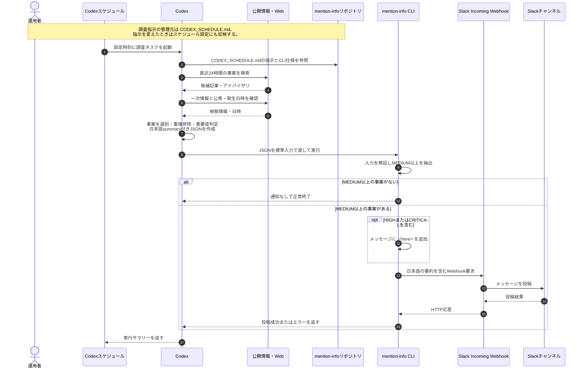

# 処理シーケンス

この図は、定期実行時に各コンポーネントが担当する処理を示します。

## 担当

- **Codexスケジュール**: 指定時刻に調査タスクを起動します。
- **Codex**: Web調査、一次情報による確認、重複排除、重要度判定、日本語JSONの作成を行います。
- **mention-info CLI**: JSONを検証し、MEDIUM以上の事案を日本語で整形してSlackへ送ります。HIGHまたはCRITICALを含む場合は`<!here>`を付けます。
- **Slack Incoming Webhook / Slack**: CLIから受け取ったメッセージをチャンネルに投稿します。

Slack Webhook URLは`SLACK_WEBHOOK_URL`環境変数からCLIが読み込みます。Codexは値を表示・記録しません。
